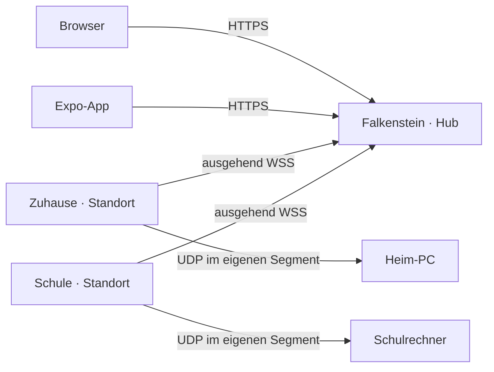

# WOL UI – Architekturvorschläge

Status aller RFCs: Entwurf. Die erste Umsetzung beginnt nach der Planungsphase.

| RFC | Entscheidung |
| --- | --- |
| [0001 – Server, Wake-on-LAN und Geräte](0001-server-und-wake.md) | Rust mit Tokio/Axum, SQLite und lokaler UDP-Ausführung |
| [0002 – Standorte und WOL Connect](0002-standorte-und-connect.md) | Selbst gehosteter Hub mit ausgehender Kopplung, direkter Betrieb pro Standort |
| [0003 – Web, Expo und Browser-SSH](0003-web-mobile-ssh.md) | React/Vite, Expo Router und gestufte Tailscale-Integration |
| [0004 – Docker, Betrieb und Umsetzung](0004-docker-und-rollout.md) | Ein OCI-Image für beide Rollen, Linux-Referenzbetrieb und prüfbare Meilensteine |

Jede Standortinstanz hat ein eigenes Inventar und bietet lokales Management. Die Hub-Oberfläche zeigt die Standorte gemeinsam an. Für die Schule setzt der Betrieb die Freigabe der zuständigen IT und ein geeignetes Netzsegment voraus. Wo ein Laptop schläft oder das Netz verlässt, übernimmt ein ständig laufender Rechner im selben Segment das Wecken.

Die Umsetzung beginnt mit einem vollständigen lokalen Ablauf von Anmeldung bis Paketversand. Danach folgen Standortkopplung, Expo und Browser-SSH. Parallel zur Planung wird keine Anwendung erzeugt.
