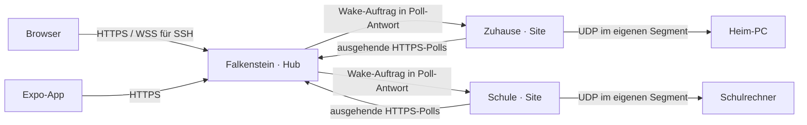

# WOL UI – Architektur und Umsetzungsstand

Die RFCs halten Zielarchitektur, getroffene Entscheidungen und offene Arbeit
fest. Der MVP ist in [PR #2](https://github.com/JackatDJL/wolui/pull/2) implementiert; der Stand
und die noch nicht erfüllten Abnahmen stehen hier pro Bereich.

| RFC | Implementiert | Noch offen |
| --- | --- | --- |
| [0001 – Server, Wake-on-LAN und Geräte](0001-server-und-wake.md) | Rust/Axum-Server, SQLite, Token-Login, Geräteverwaltung, lokale UDP-Wakes und allgemeine Einrichtungsanleitung | LAN-Nachbartabellen-Vorschläge, OpenAPI/Request-IDs, Login-Rate-Limit, Hardware-Wake-Abnahme auf Referenzgeräten |
| [0002 – Standorte und WOL Connect](0002-standorte-und-connect.md) | Einmal-Einladungen, Digest-gebundene Site-Credentials, ausgehendes HTTPS-Polling, Inventar-Snapshots, Remote-Wake, Widerruf und Offline-Sperre | Separater Multi-Host-/Netzwerktest, rollenbasierte Rechte, zweiter Pairing-Schritt und optionaler WSS-Kanal |
| [0003 – Web, Expo und Browser-SSH](0003-web-mobile-ssh.md) | React/Vite-Web-UI, Expo-App für Login/Standorte/Wake, Browser-Terminal mit Tailscale SSH und Gerätefreigabe | Native Store-Builds, Bedienungs-/Accessibility-Prüfung und Live-Abnahme mit einem erlaubten Tailnet-Ziel |
| [0004 – Docker, Betrieb und Umsetzung](0004-docker-und-rollout.md) | Ein Image für Hub/Site, amd64 CI-Build und Smoke-Test, Compose- und Dokploy-Anleitungen | Main-Branch-GHCR-Veröffentlichung, produktiver Hub/Site-Rollout, Backup-Restore-Probe, ARM64 und Ressourcenmessung |

Der aktuelle Datenpfad für WOL Connect ist HTTPS-Polling. SSH verwendet
authentifiziertes WSS. Eine Site öffnet nur ausgehende Verbindungen zum Hub;
der Hub sendet selbst keine LAN-Broadcasts.

Jede Site hat ihr eigenes Inventar und einen lokalen Zugang. Der Hub zeigt die
Standorte gemeinsam an. Für einen Standort in der Schule setzt der Betrieb die
Freigabe der zuständigen IT und ein geeignetes Netzsegment voraus. Wenn ein
Laptop schläft oder das Netz verlässt, übernimmt ein ständig laufender Rechner
im selben Segment das Wecken.

Die RFCs bleiben Referenz für weitere Ausbaustufen. Nicht implementierte
Architekturvorschläge wie `crates/wol-protocol`, ein generierter gemeinsamer
API-Client, WSS für Connect und native App-Store-Builds sind keine Eigenschaften
des aktuellen MVP.
